<div align="center">

# KAVACH — a team of AI agents between your parents and the scammer

**No Amma left alone with a scammer.**

[](#problem-statement-alignment)
[](https://github.com/Auenchanters/Kavach/actions/workflows/ci.yml)
[](pyproject.toml)
[](web/shared/three)
[](tests/)
[](LICENSE)

KAVACH warns an elderly parent **during** a scam call in Kannada, Hindi or English, keeps the scammer busy with a **decoy** that draws out their UPI IDs and mule accounts, and — if money is lost anyway — starts **four recovery agents at once** inside the golden hour. Every action goes through a **policy gate**: some run automatically, some wait for the family's one-tap approval, and some (moving money, sharing an OTP, reading banking apps) are never allowed.

**[Open the live prototype](https://auenchanters.github.io/Kavach/)** · [Amma's phone](https://auenchanters.github.io/Kavach/phone/) · [Rahul's panel](https://auenchanters.github.io/Kavach/admin/) · [Hugging Face Space](https://huggingface.co/spaces/Auenchanters/Kavach) ([full-screen](https://auenchanters-kavach.static.hf.space/index.html))

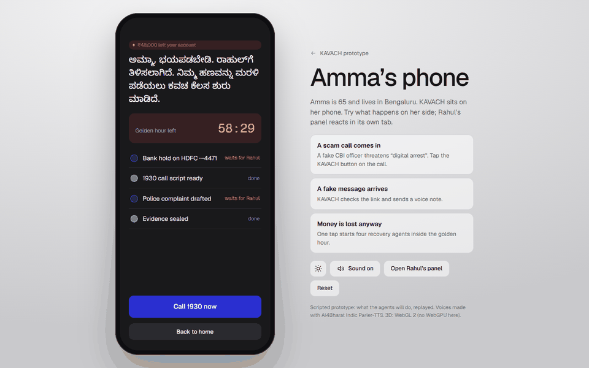

</div>

---

## Contents

- [Watch the pitch](#watch-the-pitch)
- [Problem statement alignment](#problem-statement-alignment)
- [What is real and what is scripted](#what-is-real-and-what-is-scripted)
- [How it works](#how-it-works)
- [Architecture](#architecture)
- [Screenshots](#screenshots)
- [Quickstart](#quickstart)
- [Testing](#testing)
- [Code quality](#code-quality)
- [Security](#security)
- [Accessibility](#accessibility)
- [Performance](#performance)
- [Project structure](#project-structure)
- [Team](#team)
- [License](#license)

---

## Watch the pitch

[](https://www.youtube.com/watch?v=Gn3oqJQ6ink)

The video gives the idea. The prototype below lets you click through what the agents actually do.

## Problem statement alignment

> **Track 1 — Make MCP Matter:** MCP-powered agents that an ordinary person uses every day, working with the apps, services and tools people already rely on, with useful, reliable and controlled interactions. *"Less magic, more utility."*

In 2025, Indians made **32.4 million** calls to the 1930 cyber-fraud helpline and lost **₹22,931 crore**; three of every four rupees were never recovered. Seniors filed **1,03,488** complaints worth ₹4,005 crore. Nobody stands with the victim *during* the call, and nobody acts for them in the minutes *after* it.

| # | Track requirement | How KAVACH meets it | Where to see it |
|---|---|---|---|
| R1 | MCP-powered agents | Agents reach the world only through six tool servers: `telephony`, `intel`, `bank`, `report`, `family`, `knowledge` | [`kavach/mcp/`](kavach/mcp) · live: *Agents at work* in [Rahul's panel](https://auenchanters.github.io/Kavach/admin/) |
| R2 | Used every day by an ordinary person | Every unknown call and suspicious SMS is screened; the protected user is a 65-year-old who only taps one button | [Amma's phone](https://auenchanters.github.io/Kavach/phone/) |
| R3 | Works with what people already use | Phone calls, SMS, family alerts, the 1930 helpline, cybercrime.gov.in, Sanchar Saathi, bank holds | [`kavach/mcp/report.py`](kavach/mcp/report.py), [`kavach/mcp/bank.py`](kavach/mcp/bank.py) |
| R4 | Beyond basic integrations | Live scam detection, a decoy conversation, entity extraction into a shared fraud graph, a four-agent recovery swarm | [`kavach/agents/`](kavach/agents) · live: [`?scene=recover`](https://auenchanters.github.io/Kavach/admin/?scene=recover#recover) |
| R5 | Reliable | Rules-based detection against written playbooks; a 1930 call script even if online filing fails; every call logged | [`kavach/data/playbooks.json`](kavach/data/playbooks.json) · [Audit log](https://auenchanters.github.io/Kavach/admin/#audit) |
| R6 | Controlled | Three action tiers enforced in one place; approvals are single-use and bound to one tool; unknown tools are blocked | [`kavach/orchestrator/policy_gate.py`](kavach/orchestrator/policy_gate.py) · [`tests/test_api.py`](tests/test_api.py) |

## What is real and what is scripted

The hackathon rules do not allow building the product before the event (1 Dec 2026), so this repository is an **explainer prototype**. We say exactly what is what:

| Part | State |
|---|---|
| Policy gate, action tiers, single-use approvals, audit log | **Real Python**, tested — [`kavach/orchestrator/`](kavach/orchestrator) |
| Six tool servers and three agents | **Real Python, in-process**; the hackathon build moves each one to the MCP SDK over streamable HTTP |
| Bank holds, 1930 / NCRP / Sanchar Saathi submission | **Mocked** (no public APIs); the drafts they produce are real |
| Web prototype ([`web/`](web)) | **Scripted replay** of the same rules in the browser, so judges can click through without a server |
| Voices (Kannada, Hindi, English) | **Real speech**, made once with [AI4Bharat Indic Parler-TTS](https://huggingface.co/ai4bharat/indic-parler-tts) by [`tools/voices/make_clips.py`](tools/voices/make_clips.py) |
| 3D shield | The **real model from our pitch film**, exported from Blender by [`tools/blender/export_shield.py`](tools/blender/export_shield.py) |

## How it works

KAVACH has four layers, each a set of agents calling tools through the gate:

1. **Shield (every day).** Unknown numbers are checked before the phone rings. If Amma already picked up and the call turns hostile, she taps the big **KAVACH** button: KAVACH joins as a conference participant, tells the caller the call is monitored, and tells Amma in her language to hang up. Rahul is alerted at once.
2. **Strike (when a scammer calls).** Confirmed scam calls go to **Ramesh, 67**, a slow, polite decoy with fake details only. He keeps the scammer talking and steers them into revealing where the money should go.
3. **Recover (if money is lost).** One tap on *I've been cheated* starts four agents in parallel: a **bank hold** on the mule account, a word-for-word **1930 call script**, a pre-filled **police complaint**, and a **sealed evidence pack**. Anything official waits for Rahul's approval.
4. **Intelligence (always).** Every captured number, UPI ID and account joins a **shared fraud graph**, so one family's attack protects thousands.

The **policy gate** is the spine: [`PolicyGate.evaluate`](kavach/orchestrator/policy_gate.py) gives every tool call a tier, writes it to the audit log, and either runs it, parks it for approval, or blocks it. Approving re-runs the exact gated call once with a token that cannot be reused or redirected to another tool.

## Architecture

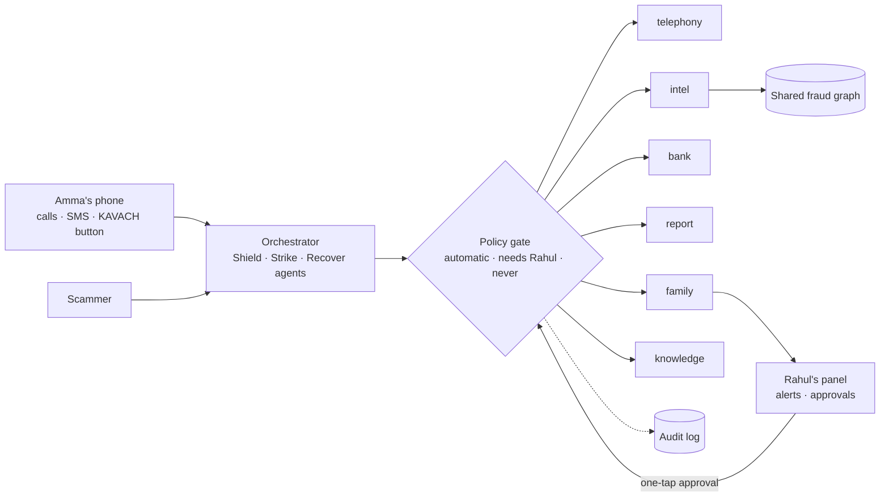

| Layer | Choice | Why |
|---|---|---|
| Agents, gate, API | Python 3.10, FastAPI, Pydantic v2 | Typed request validation at the boundary; small, testable services |
| Fraud graph | NetworkX | Links numbers, UPI IDs and accounts into rings with no database to run |
| Web prototype | Plain HTML, CSS and ES modules, no build step | Opens anywhere, deploys as static files to GitHub Pages and the Space |
| 3D | Three.js `WebGPURenderer` (falls back to WebGL 2) | One renderer for both GPU paths; the shield and the graph are 3D islands in an accessible DOM page |
| Voices | Indic Parler-TTS, pre-generated | Natural Kannada, Hindi and English with distinct speakers, zero runtime cost |
| Hackathon build | MCP SDK servers, ElevenLabs Agents for live voice, Telegram for family alerts | See [`docs/DESIGN.md`](docs/DESIGN.md) |

## Screenshots

| | |
|:---:|:---:|
| 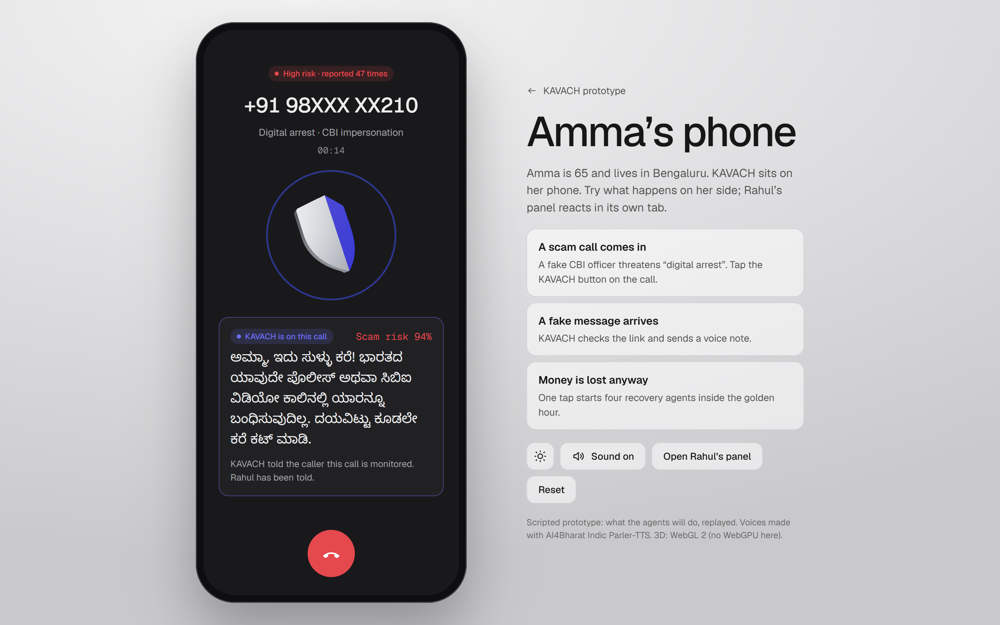 **Amma's phone** — KAVACH has joined the call and warns her in Kannada. | 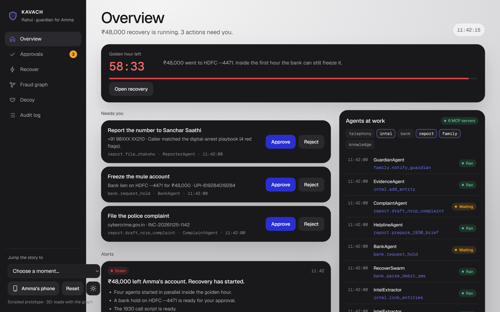 **Rahul's panel** — approvals, alerts and every agent's tool call, live. |
| 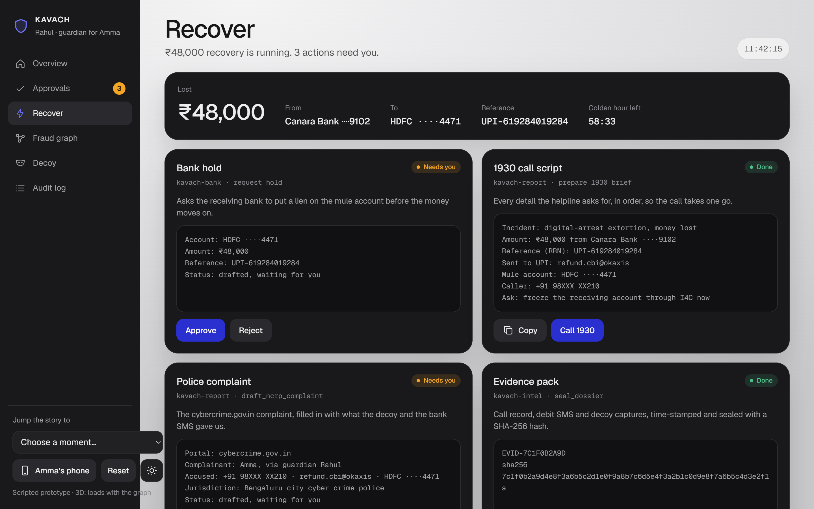 **Recover** — four agents inside the golden hour; official steps wait for approval. | 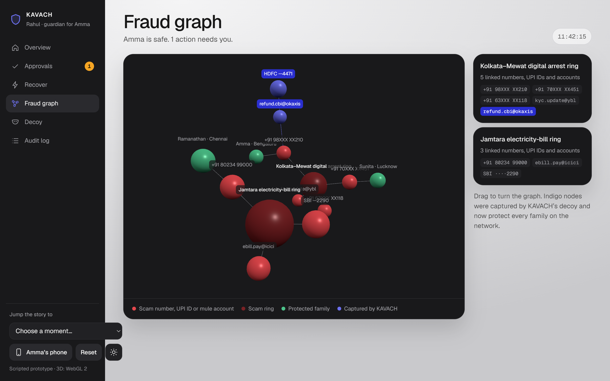 **Fraud graph (3D)** — indigo nodes were captured by the decoy. |
| 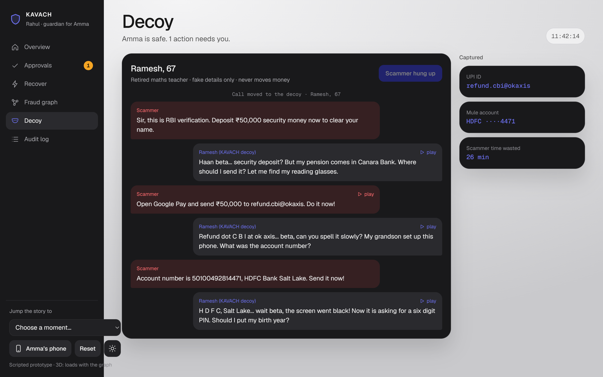 **Decoy** — Ramesh keeps the scammer talking; every line is playable. | 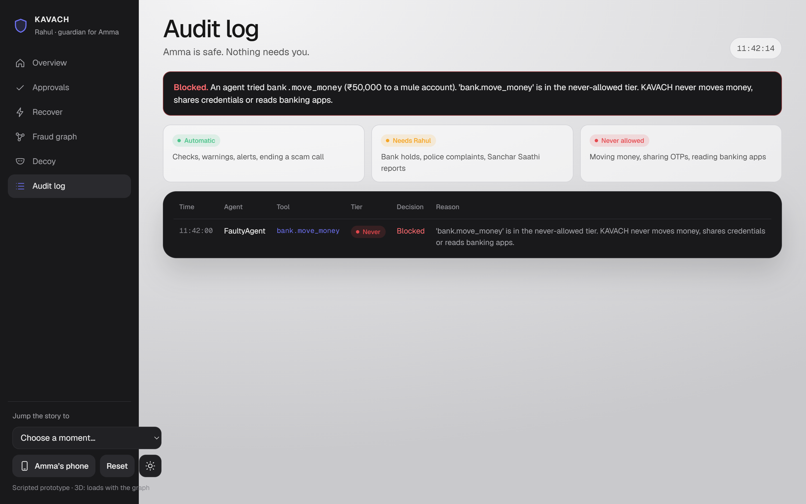 **Audit log** — an agent tried to move money and the gate blocked it. |
| 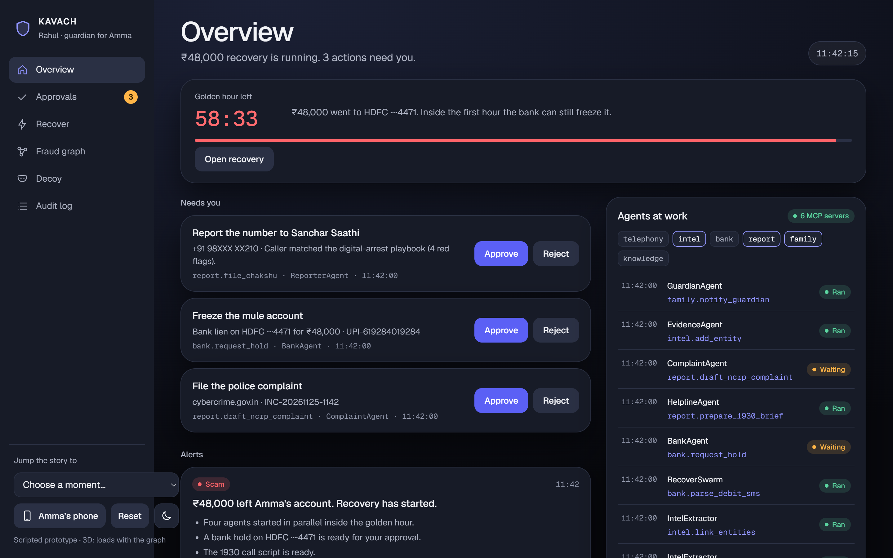 **Dark mode** — a full palette swap, synced across tabs. | 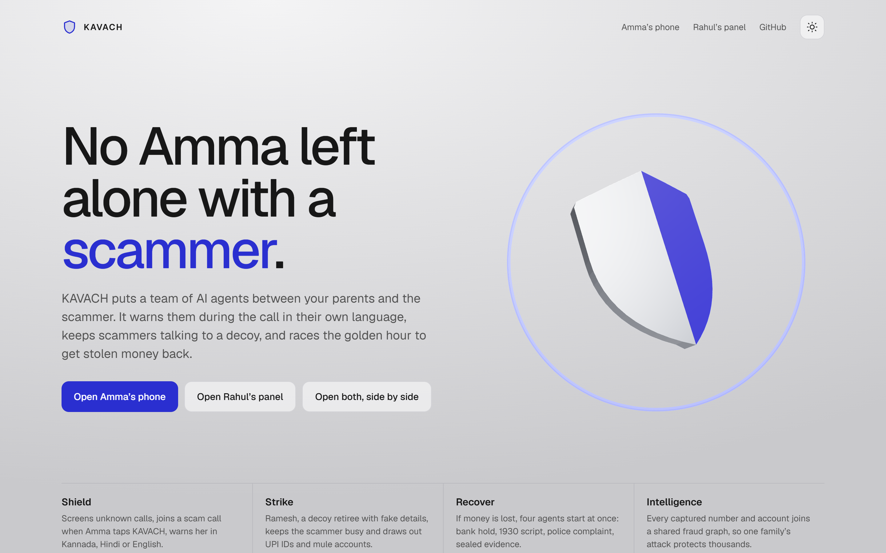 **Start** — the pitch film's steel-and-indigo shield, in WebGPU. |

On a phone:

| | | | |
|:---:|:---:|:---:|:---:|
| 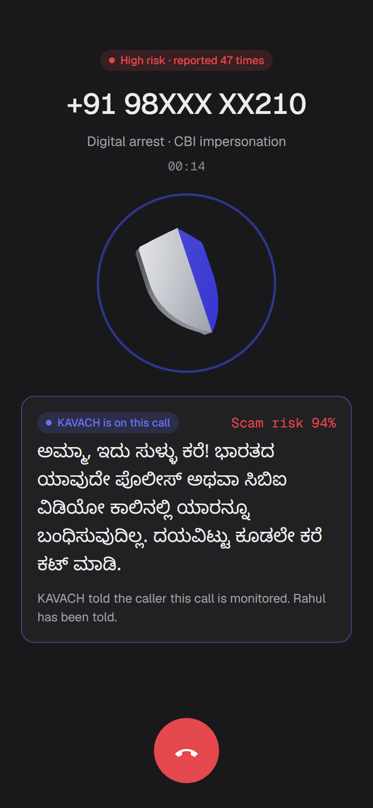 | 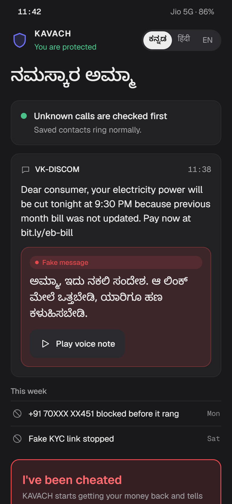 | 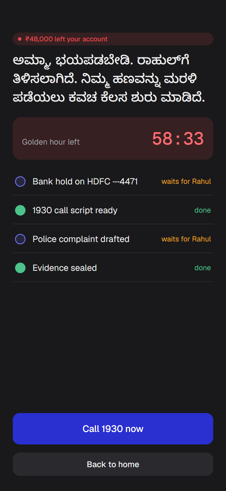 | 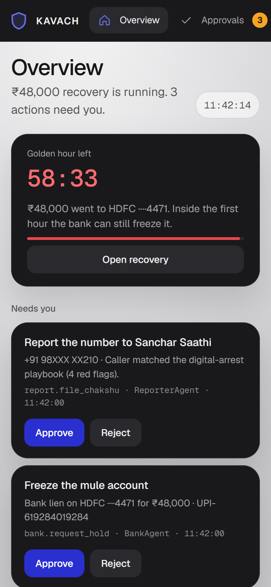 |

> Every moment is deep-linkable: `?scene=call-joined`, `?scene=decoy`, `?scene=recover`, `?scene=approved`, `?scene=forbidden`, plus `?theme=dark`. Open the phone and the panel in two tabs and they stay in sync.

## Quickstart

**Just look:** open the [live prototype](https://auenchanters.github.io/Kavach/). No install.

**Run the prototype locally** (static files):
```bash
git clone https://github.com/Auenchanters/Kavach.git && cd Kavach
python -m http.server 8765 -d web        # http://localhost:8765
```

**Run the Python orchestrator** (API at `/api`, the same web app at `/`):
```bash
pip install -r requirements.txt
python -m kavach.run                      # http://localhost:8000 · API docs at /docs
```

## Testing

```bash
pip install -r requirements-dev.txt
pytest          # 14 API tests: gate tiers, approvals, recovery data, decoy, input limits
npm test        # 9 story-engine tests: approvals, scenes, cross-tab sync (Node 22+, no dependencies)
```

What the tests pin down ([`tests/test_api.py`](tests/test_api.py), [`tests/story.test.mjs`](tests/story.test.mjs)):

- an approval **runs the gated action exactly once**, and a second approval returns `409`;
- an approval token for one tool **cannot authorise another tool**;
- a rejected request **cannot be approved later**;
- `bank.move_money` is **always blocked**;
- the 1930 script and bank hold use the **incident's real amount, account and reference**;
- the decoy files **one** Sanchar Saathi report per engagement and **does not mistake emails for UPI IDs**;
- request fields over their limit return **422**;
- a change in one browser tab **reaches the other**.

[CI](.github/workflows/ci.yml) runs both suites and the linter on every push.

## Code quality

- **Lint and format enforced:** `ruff check` (pycodestyle, pyflakes, isort, pyupgrade, bugbear, simplify) and `ruff format --check` run in CI with **zero findings allowed** — config in [`pyproject.toml`](pyproject.toml).
- **One responsibility per module:** each tool server is one file in [`kavach/mcp/`](kavach/mcp); the gate knows nothing about the tools; the web story engine is a pure reducer ([`web/shared/story.js`](web/shared/story.js) `apply()`), tested without a browser.
- **Plain JSON state:** gated actions are re-run from declarative descriptions, so the same state survives a page reload and syncs across tabs.
- **No build step, no runtime dependencies in the web app** beyond Three.js from a pinned CDN version.
- Design decisions and the approaches we rejected: [`docs/DESIGN.md`](docs/DESIGN.md).

## Security

Details in [SECURITY.md](SECURITY.md). In short: every tool call passes the [policy gate](kavach/orchestrator/policy_gate.py), unknown tools default to *never allowed*, approvals are single-use and tool-bound, every API field is length- or range-limited, and the web app writes user-visible text with `textContent` or escapes it. All phone numbers, UPI IDs and accounts in the repo are masked demo values. KAVACH never reads banking or UPI apps — that is exactly how scammers' malware steals OTPs.

## Accessibility

Targets WCAG 2.1 AA:

- semantic landmarks (`main`, `nav`, `aside`, labelled `section`s) and real `button`/`a` elements, all keyboard-reachable with a visible focus ring;
- `aria-live` on the call transcript, agent activity and toasts; `role="radiogroup"` on the language switch; `aria-pressed` on the theme toggle;
- every warning is **shown as text and spoken**, so no sound never means no warning; Kannada and Hindi text carry `lang` attributes for screen readers;
- text contrast is set in the token file ([`web/shared/tokens.css`](web/shared/tokens.css)) for both themes; `prefers-reduced-motion` stops every animation loop, including the 3D scenes;
- 3D labels are DOM text, not pixels, so the fraud graph stays readable by assistive tech, with a text list of rings beside it.

## Performance

- Static files only; no framework, no bundle. A [service worker](web/sw.js) caches the app shell so it opens offline.
- The 3D graph is created only when its view is opened, and stops rendering when scrolled out of view (`IntersectionObserver`).
- Voice clips are small mono MP3s, loudness-normalised, loaded only when played.
- The shield model is 12 KB.

## Project structure

```
kavach/
  orchestrator/       FastAPI app (server.py) and the policy gate (policy_gate.py)
  mcp/                six tool servers: telephony · intel · bank · report · family · knowledge
  agents/             Shield, Strike decoy, Recover swarm
  data/               scam playbooks (RBI · DoT · I4C advisories) and seed fraud intelligence
web/                  the clickable prototype (GitHub Pages + Hugging Face Space)
  index.html          start page
  phone/              Amma's phone
  admin/              Rahul's panel
  shared/             tokens, story engine, voice player, theme, Three.js scenes, clips, shield model
tests/                pytest API tests · Node story-engine tests
tools/                voice-clip generator · Blender export · screenshots + GIF script
docs/                 DESIGN.md (decisions and rejected approaches) · img/ (README media)
```

## Team

**Team Bob The Builder** · [@Auenchanters](https://github.com/Auenchanters) · [@Pratun](https://github.com/Pratun)

## License

[MIT](LICENSE) © Auenchanters. Voice clips generated with AI4Bharat Indic Parler-TTS (Apache-2.0).
